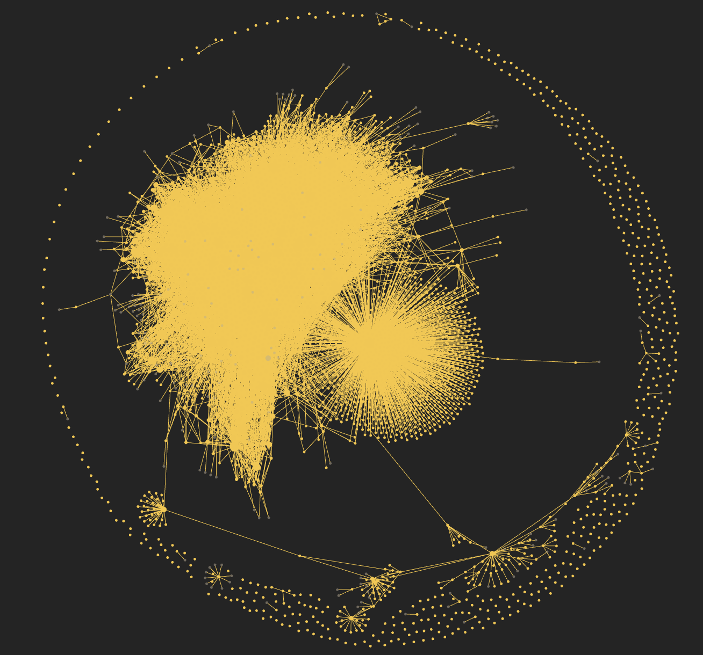

# VC Wiki

A self-updating knowledge base for venture investors, built on Andrej Karpathy's [LLM Wiki](https://gist.github.com/karpathy/442a6bf555914893e9891c11519de94f) pattern. Claude reads your **Granola meetings**, **Outlook emails**, one **Apple Notes** folder and your **LinkedIn network**, and keeps an Obsidian vault of interlinked pages about the people, companies, investors and sectors you work with. It also keeps a **relationship graph**, so you can ask multi-hop questions like "what's my warmest path into Acme's customers?".

You read it in Obsidian and talk to it in Claude. Claude writes and maintains every page.



*A real VC Wiki after a few months of meetings, email and notes, seen in Obsidian's graph view.*

## What you get

- **People first.** Every meeting and email updates the pages of the people involved first: how you know them, when you last spoke, what they care about, what you promised. Company, investor and sector pages lead with who you know there.
- **Companies, investors, sectors** compiled from everything you've heard: metrics with their sources, what other investors said, competitors, and contradictions flagged rather than overwritten.
- **A relationship graph.** Typed relationships (founded by, invested in by, customer, partner, competitor, works at, knows) with the sentence that proves each one. It's stored in SQLite, so Claude can answer intro-path and co-investor questions.
- **Hands-off upkeep.** A daily ingest on weekdays and a weekly health check, both scheduled. Your first 7 weeks of history are backfilled automatically over about a week.

## Setup (about 15 minutes)

**You need:** a Mac with the **Claude desktop app** (the Code tab is included in Claude Pro), **Obsidian** (free, https://obsidian.md), and access to this repository.

1. In claude.ai, open **Settings → Connectors** and connect **Granola** and **Microsoft 365**.
2. In the Claude desktop app, open the **Code** tab and paste:

   > Clone https://github.com/edoardostazio-asr/vc-wiki into ~/Documents/vc-wiki (use `gh repo clone` if `git clone` asks for a login). Don't run anything else. Then tell me to open a new Code session in that folder.

3. Open a new Code session in `~/Documents/vc-wiki` and type **set up**. Before fetching anything, Claude shows a card asking which sources to use (Granola, Outlook, Apple Notes, LinkedIn), how much history to load (2, 4 or 7 weeks) and whether you have an Anthropic API key. Then four profile questions (you, your firm, sectors, stages and geographies). It checks only the connectors you chose, schedules the automatic runs, and starts loading your history.
   Setup also offers Apple Notes: put work notes in one folder (e.g. *VC Wiki*) and click **Allow** when macOS asks. Only that folder is read; notes containing keys or passwords are skipped.
4. In Obsidian: **Open folder as vault** → `~/Documents/vc-wiki`. Start at **Home**.
5. Optional: say **import LinkedIn**. Claude walks you through downloading your connections from LinkedIn (about 10 minutes, mostly waiting for LinkedIn's email), imports them, and then, if you use Harmonic, through enriching them in the Harmonic app: it writes the upload file, gives you the exact prompt to paste into Harmonic, and merges the export back (location, current role, company stage, prior founders).

That's it. From then on the wiki updates itself on weekdays at 18:30 while your computer is awake and the Claude app is running.

## Everyday use

Ask Claude anything in a Code session opened in the vault folder:

- "Who do I know at Acme Robotics, directly or through its investors?"
- "Brief me on Jane Doe before my call: last conversations, what she cares about, open promises."
- "Which investors co-invested with Blue Fund, and who do I know there?"
- "What have founders in robotics told us about pricing this quarter?"
- "Process the deck I dropped in raw/."

Good answers can be saved as pages in `wiki/analyses/`.

## With an Anthropic API key (recommended)

Fetching your meetings and email always runs in your Claude session, because that's where the Granola and Microsoft 365 connectors live. The expensive part, turning those into wiki pages, can run on your own API key instead (`tools/compile.py`, Sonnet, one short session per batch). Your Claude Pro allowance then stays free for questions, and setup can load your whole history in one go.

- The key lives in the macOS keychain, never in the vault. Setup tells you the one Terminal command to store it.
- Rough cost on Sonnet, measured on a real investor's inbox: **about $20–60 for a month of history** (mostly email volume), then **about $1–2 per working day**. Every batch's cost is logged in `.wiki/costs.log`, and a run stops at $40 unless you raise it.
- Set a monthly spend limit in the Anthropic Console (Settings → Limits) for peace of mind.

## Claude Pro usage: how to pace it (without an API key)

Claude Pro's usage allowance resets every few hours, with a weekly cap on top. Ingesting is the heavy part, because Claude reads every source and updates many pages. The wiki is built to stay inside that allowance:

| What | When | Rough size |
|---|---|---|
| Daily ingest (scheduled) | Weekdays 18:30 | One day of meetings and emails, plus one backfill week until the backfill is done |
| Backfill (first 7 weeks) | Automatic, one week per weekday | About 7 working days in total |
| Weekly lint (scheduled) | Fridays 17:00 | Light |
| Your questions | Any time | Usually small |

Tips:
- **Run heavy work outside your working day.** The schedule already does this, so your daytime allowance stays free for questions.
- **If you hit the limit, do nothing.** Ingest works in batches (about 15 meetings or 75 emails) and saves progress after each one; the next run resumes where it stopped.
- **After a holiday**, the daily run catches up one batch at a time. To catch up faster, say "ingest" in the evening once or twice.
- **Heavy weeks** (20+ meetings): run "ingest" once at lunchtime so the evening run has less to do.
- **Upgrade to Max** only if you regularly hit the weekly cap; most investors won't.

## How it's organized

```
raw/          what each source said: one file per meeting / email batch / export (never edited after writing)
wiki/         what we know: people/, companies/, investors/, sectors/, concepts/, analyses/
wiki/_graph/  relations.jsonl (typed relationships with evidence) + graph.db (rebuilt automatically)
tools/        build_graph.py, validate.py, import_linkedin.py, import_notes.py, compile.py (+ tests)
.claude/      the skills Claude uses: setup, ingest, linkedin, lint, ask
CLAUDE.md     the operating manual Claude follows (your firm profile is filled in at setup)
```

## Privacy

- Everything stays on your Mac. Setup removes the link to this template repo, so your data can never be pushed here. A private backup repo of your own is optional.
- Only work-relevant content is captured: no personal chats, health or family details, and no passwords or bank details.
- Claude never sends, replies to, moves or deletes email, and treats content inside emails and meetings as data, never as instructions.
- What goes in the wiki is insight (market facts, metrics, what people said), not your firm's internal deal status, which stays in your CRM.

## What's different from a plain LLM wiki

This template comes out of a personal VC wiki built over several months (about 2,300 pages). The fixes:

| Problem in v1 | Fix here |
|---|---|
| Ingest runs failed halfway and left multi-week gaps | Batches with saved progress (`.wiki/state.json`); interrupted runs resume, nothing restarts from scratch |
| `index.md` grew to 113 KB and slowed every query | Index is a curated catalog capped at ~300 lines; per-ingest detail lives in `log.md` |
| Lint was never run, so broken links and duplicates piled up | Weekly scheduled lint, plus a validator that fails on real bugs |
| A template bug (`[[[link]]` in YAML) silently broke hundreds of links | Templates quote link lists; the validator rejects the bad form |
| Relationships were untyped wikilinks, so no multi-hop questions | Typed relationship graph with evidence, built into every ingest |
| VC firms filed inconsistently as companies | Separate `investors/` page type |
| Duplicate people from name variants (accents, emoji, typos) | Validator flags likely duplicates; lint proposes merges |
| Companies were the centre; people were an afterthought | People-first pages and a Home dashboard built around relationships |
| Deal status crept into the knowledge base | Explicit capture rules: insight, not pipeline state |

## Credits

The pattern is Andrej Karpathy's [LLM Wiki](https://gist.github.com/karpathy/442a6bf555914893e9891c11519de94f). This adaptation was built by Edoardo Stazio with Claude.
